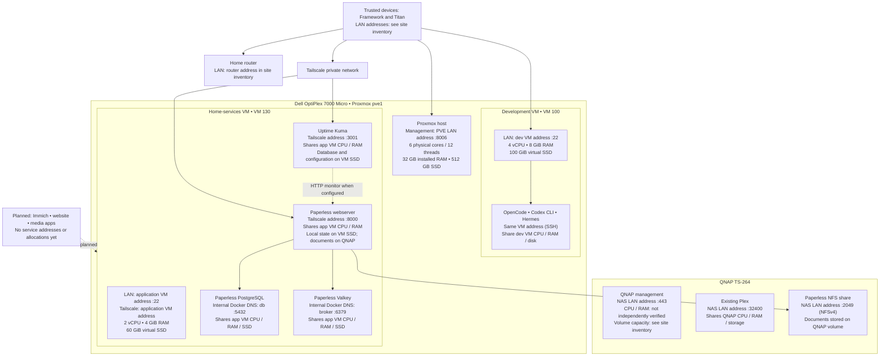

# Homelab topology, resources and addresses

This is a dated reference, not a live inventory. The diagram deliberately uses address placeholders: real addresses remain in ignored `config/site.json`. The local site-specific copy is `.local/homelab-resource-diagram.md`; regenerate and verify its values before using it. Quantities below are configured VM allocations or observed host hardware, not current utilization.

- **Not yet drawn (2026-10-28):** VM 101 `hermes-agent` (4 vCPU, 8 GiB, 80 GiB; Hermes, rootless Docker; public egress only) and the QNAP `proxmox-backups` share that receives backups of all three VMs. The Hermes tools shown on the development VM are a dormant install. See the [status handoff](../agents/handoffs/homelab-status-2026-10-28.md).
- Paperless, PostgreSQL, Valkey and Uptime Kuma have **no individual CPU or memory reservation or limit**. All share the home-services VM's 2 vCPUs and 4 GiB RAM with Ubuntu and Docker. Their disk data grows within the VM SSD allocation or the QNAP volume; there are no separate per-service disk quotas configured. Docker-internal DNS names are not LAN addresses and IPs can change.
- Development tools share their VM's 4 vCPUs, 8 GiB RAM and 100 GiB virtual disk. Their SSH access is through the VM; they do not have separate service IPs. Tailscale on that VM last reported `NeedsLogin`.
- VM vCPUs are virtual, not reserved physical cores. Virtual SSD sizes are not guarantees of free physical SSD capacity. The host's CPU, memory and physical SSD are shared across Proxmox and VMs.
- Both VMs were enabled for Proxmox autostart on 2026-10-27 (`onboot: 1`, `startup order=1` for the dev VM and `order=2,up=30` for home-services). A physical host reboot that day started VM 100 then VM 130 automatically, and the guest startup units brought Paperless and Uptime Kuma back without intervention. Guest services still have their own startup behavior, documented in their runbooks.
- The QNAP volume's capacity and free space were supplied by the owner in screenshots and may change. NAS CPU/RAM allocations have not been verified. Existing Plex storage remains untouched.
- The Kuma UI is deployed privately; its initial administrator and HTTP monitor are separate interactive setup steps. It cannot report the application VM's own outage while running on that VM. Planned applications have no verified allocations or addresses. Self-hosted n8n is outside current scope; VM backups to the QNAP are live (see [Proxmox backups](proxmox-backups.md)).
