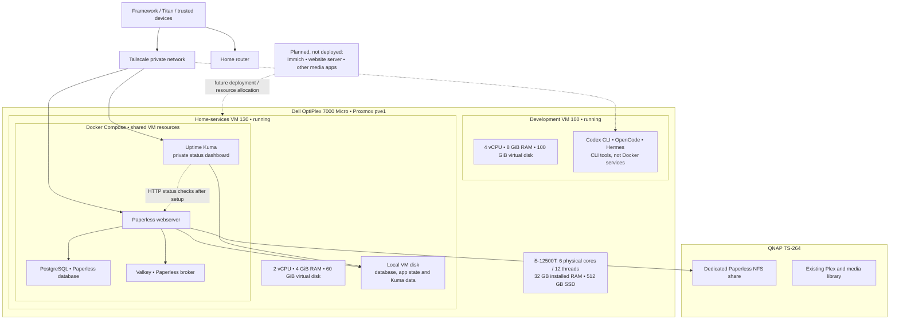

# Homelab topology and resources

This is a dated snapshot, not a live inventory. Verify actual allocations and state before making changes. Addresses, credentials and export paths belong in ignored site configuration.

- VM sizes are configured allocations, not dedicated physical cores. The host's CPU and SSD are shared across the VMs and Proxmox; 100 GiB and 60 GiB are virtual disk sizes, not guarantees of free physical SSD capacity.
- Paperless, its database and broker, and Uptime Kuma have no separate CPU or RAM reservations or limits; they share the 2 vCPUs and 4 GiB of their VM with Ubuntu and Docker. Actual usage changes over time. Kuma data and Paperless's database are on the VM SSD; Paperless's document storage is on QNAP.
- The development VM has 4 vCPUs and 8 GiB RAM shared by its tools and Ubuntu. CLI login and provider configuration are separate from installation.
- Both configured VMs have Proxmox `onboot: 0` as observed on 2026-10-27: a VM reboot exercises guest services, but a full Proxmox host reboot will not automatically start these VMs. Changing that requires explicit host-infrastructure approval.
- Uptime Kuma's dashboard container and private UI are deployed only when confirmed in the service runbook; creating the admin account and configuring monitors are separate steps. The dashboard runs on the same VM as Paperless, so it cannot report an outage while that VM is down.
- Future applications have no assigned resources yet. Self-hosted n8n and QNAP backups are outside current scope; QNAP Plex and its existing library remain in place. No public ingress is configured by these diagrams.
